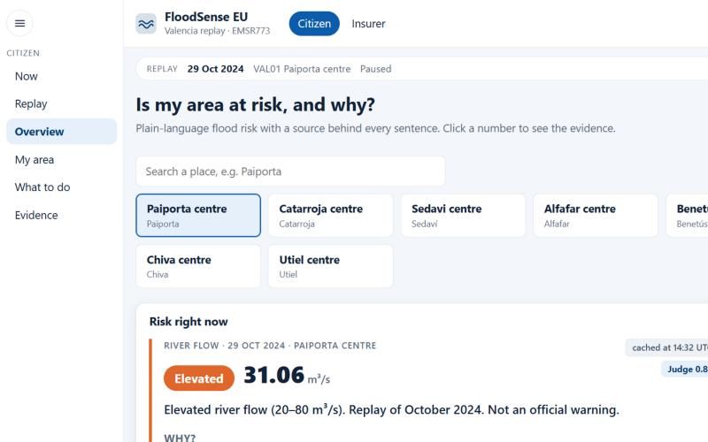
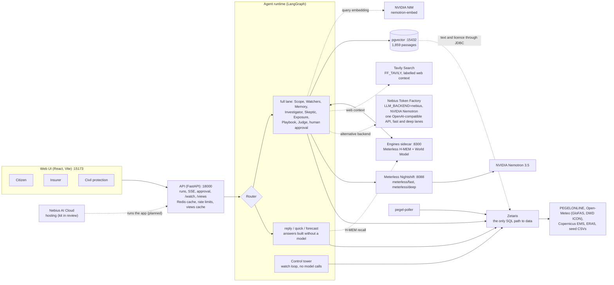

# FloodSense EU

FloodSense EU explains why a place in Europe is at flood risk, with a citation for every sentence: a Zetaris query, a stored document passage, or a memory a person approved. It watches 45 places live, answers plain questions in seconds, runs a full multi-agent investigation when a question needs one, and nothing leaves the system until a person approves it.

Open Agent Hackathon 2026, Track 02. Release 1.0.1 (tag `v1.0.1`, the submitted version): [release notes](docs/RELEASE-NOTES-v1.0.1.md), product description in the [1.0.0 notes](docs/RELEASE-NOTES-v1.0.0.md), [changelog](CHANGELOG.md).



## Three desks

One console, switched in the header (Citizen | Insurer | Civil protection):

- **Citizen**: is my street at risk, and what do I do? Pages: Now, Replay, Overview, My area, What to do, Evidence, How it works.
- **Insurer** (the payer): which insured sites are exposed, and what do we tell the customer? Pages: Control tower, Now, Replay, Approvals, Portfolio, Sites / map, Alerts, Review, System, How it works.
- **Civil protection** (the paying customer on the public side): which rivers and places need attention first, what is the next 48 hours, and what do hotline staff, who are not flood experts, tell callers? Pages: Situation board, Approvals, How it works. The Situation board gives a one-screen brief per river with a fixed call script (German and English; Spanish for Spanish places) and official links. "Escalate to agents" starts a full run, and its proposed actions land in this desk's own approval queue.

The header also has **Live | Past flood** (Ahr 2021, Valencia 2024) and a **Demo data** switch. The **Control tower** shows a rule-based watch loop (no model calls) scanning the 45 sources on its own; an opt-in, capped auto-assess may start a full run but never approves anything.

Each message goes through a router with four lanes: `reply` (greetings and help), `quick` (a live reading, about 1 s), `forecast` (the next 48 hours or this week, 1 to 4 s) and `full` (the multi-agent run with the Skeptic, the Judge and human approval, 5 to 6 minutes on Nemotron). The first three build their answers from data and fixed templates, without a model; only an ambiguous message may use one short classification call on the fast lane.

## Architecture



The diagrams in [docs/architecture/c4.md](docs/architecture/c4.md) are the detailed version. Agents never call a public data source themselves, and every chat model call goes through one backend: Nightshift (default) or Nebius Token Factory (`LLM_BACKEND=nebius`).

## How the sponsors are used

- **Zetaris: the only SQL path to the data.** Hazard, exposure, gauge, provenance and document metadata are read only through Zetaris views (FILESTORE CSV tables, REST tables that call Open-Meteo, and the pgvector database over JDBC). The numbered migrations in `zetaris/migrations/` (up to `073`) define them; `py tasks.py zetaris-sync` applies and verifies them. Every data citation carries the Zetaris `query_id`. Code: `agents/floodsense_agents/zetaris.py`.
- **Meterless Nightshift: the gateway for all Nemotron calls, plus H-MEM and the World Model.** All chat completions go through Nightshift on two lanes, `meterless/fast` and `meterless/deep`, with backoff on NVIDIA 429. The Meterless H-MEM (memory of approved findings) and World Model (hypothesis board) engines run in the `engines/` sidecar; memory is written only after a human approves. Code: `agents/floodsense_agents/nightshift.py`, `engines.py`, `nodes/memory.py`.
- **Nebius Token Factory + NVIDIA Nemotron (selectable backend).** Set `LLM_BACKEND=nebius` and `NEBIUS_API_KEY` to send the same chat calls to the Token Factory OpenAI-compatible API with NVIDIA Nemotron models instead of Nightshift. Nightshift remains the default backend. This path is covered by offline mock-transport tests only; it has not been run against the live API. Code: `NebiusClient` in `agents/floodsense_agents/nightshift.py`.
- **NVIDIA: Nemotron 3.5 models and NIM embeddings.** Nightshift routes the lanes to NVIDIA Nemotron (`nvidia/nemotron-3.5-lightning-30b-a3b` in every measured call on 27 Oct 2026). Document embeddings come from NVIDIA NIM `nvidia/nemotron-3.5-embed-1b`, the one model call that does not go through Nightshift (ADR 0009). Code: `agents/floodsense_agents/nim_embed.py`, `scripts/rag_ingest.py`.
- **Tavily: current public web context.** With `FF_TAVILY=true` and `TAVILY_API_KEY` set (default off), the full-lane Investigator makes one Tavily Search call per place and adds up to three snippets as claims labelled "Web context, not an official warning", each cited with its URL and retrieval time. Web text is cleaned (digits and units removed, markup, quotes and newlines stripped, length capped) and shown only as a quoted excerpt, so it carries no numbers into a claim; web claims have no severity and are never red; a failed or empty call is skipped silently. The Skeptic also compares one alert-timing claim with the web snippets (untrusted quoted data; it records supports, contradicts or neutral with the URL, and never changes a verdict), the call shows as its own trace entry (query, result count, latency, cached), and the evidence drawer and the "How this answer was made" panel show web citations and a Tavily tile. Live Tavily calls are not yet verified against a real key. Code: `agents/floodsense_agents/tavily.py`.
- **Cursor: see [How we built it](#how-we-built-it).**

Each answer in the UI has a "How this answer was made" panel with one tile per technology. The sponsor details with file references are in [docs/SUBMISSION.md](docs/SUBMISSION.md).

## Built on Nebius and NVIDIA

Entry for the Nebius x NVIDIA Global AI Hackathon, track Best Apps and Agents. FloodSense was built 22 to 27 Oct 2026; the Nebius port (Token Factory backend, Tavily web context, Nebius hosting kit) is the main new work of the submission period. Submission pack: [docs/SUBMISSION-NEBIUS.md](docs/SUBMISSION-NEBIUS.md).

- **Runtime call to Token Factory with NVIDIA Nemotron.** `LLM_BACKEND=nebius` sends every chat completion to `POST https://api.tokenfactory.nebius.com/v1/chat/completions` (OpenAI-compatible, Bearer `NEBIUS_API_KEY`; override with `NEBIUS_BASE_URL`). Code: `NebiusClient` in `agents/floodsense_agents/nightshift.py`, settings in `agents/floodsense_agents/settings.py`.
- **Which Nemotron, per lane.** Defaults on main: fast lane `NEBIUS_MODEL_FAST=nvidia/NVIDIA-Nemotron-3-Nano-30B-A3B` (Investigator, Skeptic rationale, Playbook first draft, front door); deep lane `NEBIUS_MODEL_DEEP=nvidia/Nemotron-3.5-Super-VL` (Judge grounding, Playbook repair). Both are env-overridable. These ids come from Nebius web pages, not yet from a keyed `GET /v1/models`.
- **One API for all lanes.** Both lanes use the same endpoint and key; only the `model` field differs. `MODEL_FAST` / `MODEL_DEEP` are ignored in this mode.
- **Resilience.** Shared with the Nightshift client: a process-wide call gate (max concurrency and a requests-per-minute pacer, `NIGHTSHIFT_MAX_CONCURRENCY`, `NIGHTSHIFT_RPM`; the env names keep the old prefix), exponential backoff with jitter on 429 and empty responses, a total per-call time budget, and a JSON-mode downgrade if `response_format` is rejected.
- **Model id on the record.** The id that answered each step is stored in the trace (`model_id`, `duration_ms`) and on each Judge score; the UI's "How this answer was made" panel shows it. The Nebius default ids are accepted by the Judge contract enum.
- **Where Token Factory helped.** TO FILL after live runs (see "Feedback" in [docs/SUBMISSION-NEBIUS.md](docs/SUBMISSION-NEBIUS.md)). We make no speed or cost claim until measured.
- **Tavily web evidence.** With `FF_TAVILY=true` and `TAVILY_API_KEY`, the full-lane Investigator makes one Tavily Search call per place and adds up to three snippets as claims labelled "Web context, not an official warning", each cited by URL and retrieval time. Digits, markup and newlines are stripped, so web text carries no numbers into a claim. Default off. Code: `agents/floodsense_agents/tavily.py`.
- **Hosting on Nebius AI Cloud.** Hosting kit in review (no `docs/DEPLOY-NEBIUS.md` on main yet).
- **Run it with your own keys.** In `agents/.env`: `LLM_BACKEND=nebius`, `NEBIUS_API_KEY=<your Token Factory key>`, and optionally `FF_TAVILY=true`, `TAVILY_API_KEY=<your key>`. Then `python tasks.py up` (needs your own Zetaris, see Quick start). Startup fails if the key is missing.
- **Honest status.** Live Token Factory calls and live Tavily calls are not yet verified in the repo docs (offline mock-transport tests only: `agents/tests/test_nebius.py`). The 27 Oct eval figures were measured on Nightshift, not Token Factory. Nightshift stays the default backend and Zetaris the data layer.

## Quick start

You need Python 3.10+, Docker Desktop, and your own local Zetaris (UI `:3000`, REST `:8888`, JDBC `:10000`) and Nightshift (`:8088`); this repository starts neither. Fill `agents/.env` and `ingestion/.env` with your own keys after the first command. For the live demo set `FF_LIVE_DATA=true`, `FF_HMEM=true` and `FF_RAG_DOCS=true` in `agents/.env` (the examples ship them off, and with `FF_LIVE_DATA` off every question goes to the full lane). `demo-seed` warms the answer cache only when `FF_SEMANTIC_CACHE=true` is set in `api/.env`.

```powershell
py tasks.py init-env
py tasks.py up-all
py tasks.py zetaris-sync
py tasks.py demo-seed
Invoke-RestMethod http://127.0.0.1:18000/health
```

Then open `http://127.0.0.1:15173/`. On macOS or Linux use `python3 tasks.py ...`. The document corpus (pgvector) needs one more step: [docs/SUBMISSION.md](docs/SUBMISSION.md), "Document corpus for layer (c)". `py tasks.py down` stops the stack. Details, tests and ports are under [Setup details](#setup-details).

## Honest limitations

- The insurer portfolio is synthetic and labelled so. Only Valencia has a demo book.
- River discharge from GloFAS is modelled, not observed, and is shown as "model, not an official warning". The statuses (Normal, Watch, Elevated) are FloodSense's own screening, never red.
- The Ahr gauges are not on PEGELONLINE, so the Ahr is replay only. Replay values are reanalysis (ERA5, GloFAS) and are far below published peaks.
- Open-Meteo's free API is non-commercial. A forecast question makes about 45 calls.
- The full lane takes 5 to 6 minutes on Nightshift and depends on NVIDIA rate limits. Answers are English only.
- First load of the live pages takes 5 to 10 seconds. Known issues are in the [release notes](docs/RELEASE-NOTES-v1.0.0.md).
- Death-toll figures from the document corpus disagree between sources in places: see [docs/DECK-FACTS.md](docs/DECK-FACTS.md).

## How we built it

Some team members used Cursor extensively, including Cursor's Grokbot to run subagents. The repository holds one Cursor skill, `.cursor/skills/floodsense-pr-review/SKILL.md` (added in [PR #35](https://github.com/GenAI-Open-Agent-Hackathon/FloodSenseEU-Hackathon-Monorepo/pull/35)): the merge bar a Cursor cloud agent checks before and after it reviews or fixes a pull request here.

The repository's coding, review and documentation work also used coding agents with independent review agents. Every change went through a branch, an independent review and a pull request (see the pull requests in this repository). Sponsor detail: [docs/SUBMISSION.md](docs/SUBMISSION.md), "Cursor: how we built it".

## Licence

The FloodSense EU code is licensed under the [Apache License 2.0](LICENSE). Copyright 2026 FloodSense EU contributors.

Third-party content stored in the repository (the document corpus, with its licences, and the vendored Meterless engines under Apache-2.0) is listed in [THIRD_PARTY_NOTICES.md](THIRD_PARTY_NOTICES.md). Every data source and its licence is in [docs/legal/sources.md](docs/legal/sources.md).

## For judges

- [docs/RELEASE-NOTES-v1.0.1.md](docs/RELEASE-NOTES-v1.0.1.md): the submitted version (tag `v1.0.1`), a cleanup of 1.0.0 with no new features.
- [docs/RELEASE-NOTES-v1.0.0.md](docs/RELEASE-NOTES-v1.0.0.md): what the product does, evaluations, limits and known issues.
- [docs/SUBMISSION.md](docs/SUBMISSION.md): how we use Zetaris, Meterless, NVIDIA and Cursor, limits, evaluation, and a 30-second tour.
- [docs/architecture/technical-highlights.md](docs/architecture/technical-highlights.md): technical details with links to the code.
- [docs/GAMEPLAN.md](docs/GAMEPLAN.md): the plan, and the unplanned increments of 25 to 27 Oct.
- [docs/HANDOVER.md](docs/HANDOVER.md): state of the repository and what remains for humans.

## Live sources across Europe

Now page, "Europe · live watch": 26 PEGELONLINE gauges on ten German federal waterways (`pegel-poller` container; `py tasks.py pegel-poll` for a one-off run), 11 Open-Meteo GloFAS river points from Paris to Budapest (`floodsense.eu_watch`, fetched by Zetaris at query time) and 8 Valencia demo points. Gauge colours use official MHW values; GloFAS colours are a model band, not an official warning. Ask "Is the Danube at Budapest at risk right now?", "What is the Elbe at Dresden doing right now?" or "Do the next 48 hours look safe at Köln?".

Path ownership is [docs/OWNERSHIP.md](docs/OWNERSHIP.md). Proposed decisions are in [docs/adr/](docs/adr/). Release notes for every version are in [CHANGELOG.md](CHANGELOG.md) and the GitHub Releases. Tags `v0.0.0`, `v0.1.0`, `v0.2.0`, `v0.3.0`, `v0.9.0`, `v0.12.0`, `v0.13.0`, `v0.14.0`, `v1.0.0` and `v1.0.1` exist, each with a GitHub Release; `v1.0.1` is the submitted version. The tag policy is at the top of the changelog. There is no wiki.

## Team

Five peers. The Architect is one role among them, not a team lead.

| Person | Role |
| --- | --- |
| Mihir | Architect: architecture, docs and ADRs, CI/CD, security review. Zetaris and data (takeover 2026-10-25). Judge with Zain. |
| Urvashi | Zetaris expertise. Remains on the team. |
| Saleeta | Secondary on ingestion prep and the demo. Citations and the slide deck. |
| Ayush | Nightshift, H-MEM, World Model, and the engines sidecar. |
| Zain | LangGraph, human-in-the-loop, the Judge with Mihir, then the UI. |

## Setup details

You need Python 3.10+ and Docker Desktop. You do not need Make, WSL, or Git Bash. Tasks live in `tasks.py` (stdlib only):

```text
python tasks.py <command>
py tasks.py <command>
```

`py` is the Windows launcher. `python` or `python3` is the same script. Run one command per line. PowerShell 5.x does not support `&&`.

Zetaris (UI `:3000`, REST `:8888/api/v1.0`, JDBC `:10000`) and Nightshift (`http://127.0.0.1:8088/v1`) are each person's own processes. This repository does not start them.

PowerShell 5.x or 7:

```powershell
py tasks.py init-env
py tasks.py up
Invoke-RestMethod http://127.0.0.1:18000/health
py tasks.py down
```

bash (macOS or Linux):

```bash
python3 tasks.py init-env
python3 tasks.py up
curl -s http://127.0.0.1:18000/health
python3 tasks.py down
```

`init-env` copies each missing `.env.example` to `.env` and does not overwrite a file that is already there. Fill `agents/.env` and `ingestion/.env` locally. In PowerShell, `curl` is an alias of `Invoke-WebRequest` and does not accept `-s`. Use `Invoke-RestMethod`, or `curl.exe` if you want the real curl.

`up` builds and starts the API (`127.0.0.1:18000`), the agent runtime (no host port), the engines sidecar (`127.0.0.1:8300`), the UI (`127.0.0.1:15173`), and the `pegel-poller` (no port; see below). Published ports bind to loopback. It refuses to start until `api/.env`, `agents/.env`, and `ui/.env` exist. Optional profiles:

```powershell
py tasks.py up-all
```

```bash
python3 tasks.py up-all
```

That adds pgvector on `127.0.0.1:15432` and Redis on `127.0.0.1:16379`. `init-env` also copies `pgvector/.env.example`. `down` stops this project only, including those profiles, even when `pgvector/.env` was never created. It does not remove volumes and it does not stop Zetaris.

**Live German gauges need no host process.** The `pegel-poller` service (default profile, so `python tasks.py up` and `up-all` both start it; `up-all` is the one command for everything) polls the 26 PEGELONLINE stations every 600 s and copies `live.csv` into the Zetaris driver container with `docker cp`. Zetaris is a separate stack, so the poller mounts the Docker socket (`/var/run/docker.sock`; Docker Desktop on Windows and macOS provides that path inside containers, so the same compose file works on all three). It has no keys and no `.env`. Settings: `ZETARIS_CONTAINER` (default `zetaris-driver-1`) and `POLL_INTERVAL_S` (default `600`, floor `30`; lower values are raised with a log line), set in the shell or a root `.env` for Compose. If Zetaris is not up yet it logs `FAILED ... retry in 30s` (backoff 30 s to 5 min) and keeps going; `docker compose -p floodsense-app ps` shows it `unhealthy` when `live.csv` has not been refreshed for 2x the interval. Logs: `docker logs -f floodsense-app-pegel-poller-1`. `python tasks.py pegel-poll [--interval 600]` still works for a one-off run on the host; do not run both. Mounting the socket gives that container control of the Docker daemon, so use it on a development machine only.

Compose is always `docker compose -p floodsense-app` with this repo's `compose.yaml`. An exported `COMPOSE_PROJECT_NAME` or `COMPOSE_FILE` cannot point the task script at another Compose project. If you run `docker compose` yourself, pass the same `-p`.

`zetaris-sync` applies pending files in `zetaris/migrations/` and then verifies declared views. It reads `ingestion/.env` (`127.0.0.1`), not `agents/.env`. A cold laptop stages FILESTORE CSVs with `ingestion/prep/stage_local_zetaris.py` before migration 010. Details are in [zetaris/README.md](zetaris/README.md).

`test` compiles the Python packages and runs the unit tests with the current interpreter. Install the agents, API, contract, and dev requirements into a virtualenv first, then run `test` and `lint` with that interpreter. The engines tests need Node.js 22.18 or newer: `python tasks.py engines-test` (Windows: `py tasks.py engines-test`). With `ENGINES_URL` set, the agents call that sidecar: the World Model takes anomalies and hypotheses, and H-MEM recall plus write-on-approval run behind `FF_HMEM` (default off, so the graph keeps `NoMemory`). Short-term thread memory is `thread_id` on `POST /runs` and does not use the sidecar. `POST /runs?wait=false` answers 202 with the `run_id` at once and runs the graph in the background; follow it live on `GET /runs/{id}/events` (see [api/README.md](api/README.md)). Lane names are `meterless/fast` and `meterless/deep`. The one map to the model that answers today is the table at the top of [docs/architecture/c4.md](docs/architecture/c4.md). The API semantic cache and labelled replay (`v0.12.0`) sit behind `FF_SEMANTIC_CACHE` and `FF_CACHED_REPLAY`, both default off. `POST /runs` is rate limited (10 a minute per client, 2 live runs at once). `GET /system` and the insurer **System** page show memory, cache, rate limits, models and engines live. For a recorded demo, `python tasks.py demo-seed` adds labelled findings to H-MEM (reviewer `demo-seed`) and warms Redis with two approved runs; `demo-reset` and `demo-ratelimit` are described in [api/README.md](api/README.md#demo-seed). In real use the system starts empty.

PowerShell:

```powershell
py -m venv .venv
.\.venv\Scripts\python.exe -m pip install -r agents\requirements.txt
.\.venv\Scripts\python.exe -m pip install -r api\requirements.txt
.\.venv\Scripts\python.exe -m pip install -r contracts\requirements.txt
.\.venv\Scripts\python.exe -m pip install -r requirements-dev.txt
.\.venv\Scripts\python.exe tasks.py test
cd ui
npm ci
cd ..
.\.venv\Scripts\python.exe tasks.py lint
```

bash:

```bash
python3 -m venv .venv
.venv/bin/python -m pip install -r agents/requirements.txt
.venv/bin/python -m pip install -r api/requirements.txt
.venv/bin/python -m pip install -r contracts/requirements.txt
.venv/bin/python -m pip install -r requirements-dev.txt
.venv/bin/python tasks.py test
cd ui
npm ci
cd ..
.venv/bin/python tasks.py lint
```

Calling the venv interpreter directly avoids PowerShell's script execution policy, which can block `Activate.ps1`. `lint` checks that no filled `.env` file is tracked, runs Ruff, and typechecks `ui/` and `contracts/`. If `gitleaks` is on `PATH`, `lint` runs it on the checked-out ref (`--log-opts=HEAD`), not on every local branch. CI sets `FLOODSENSE_GITLEAKS_LOG_OPTS` to the pull request's commits, or to the pushed range on `main`. If the binary is missing, `lint` prints one line and continues. One command per line. Do not join them with `&&`.

Containers call Zetaris and Nightshift at `host.docker.internal` (`agents/.env`). Host-side scripts use `127.0.0.1` (`ingestion/.env`, and the host-side copies in the root `.env`). The root file is not injected into containers. `host.docker.internal` is wired with `extra_hosts: host-gateway` so Linux and WSL Docker Engine can resolve it. Docker Desktop on Windows already resolves that name. A service bound only to `127.0.0.1` on the host may still be unreachable from a container; that check is Ayush and Urvashi's.

## Layout

| Path | Purpose | Owner |
| --- | --- | --- |
| `ingestion/` | Fetch and stage datasets, seed content | Mihir. Saleeta is secondary on prep and the demo |
| `zetaris/migrations/` | Numbered SQL, applied by `zetaris-sync` | Mihir |
| `agents/` | LangGraph graph, router lanes (`reply`, `quick`, `forecast`, `full`), HITL interrupt, Judge, Control tower watch loop, engines client, short-term thread memory | Ayush, Zain |
| `api/` | FastAPI. Proxies runs, SSE, approval, `/watch/*` and `/views/{name}`; `GET /system`, `/health`, `/config`. Semantic cache and labelled replay (flags default off), views cache, rate limits | Zain, Ayush |
| `ui/` | Citizen, Insurer and Civil protection desks (Vite, React, TypeScript), global Live / Past / Demo mode | Zain. Mihir landed the console |
| `corpus/` | The 25 stored documents for RAG layer (c) and `manifest.yaml` | Urvashi, Saleeta, Mihir |
| `pgvector/` | Migrations for `rag.chunks` (optional `rag` profile) | Urvashi |
| `scripts/` | `zetaris_sync.py`, `rag_ingest.py`, `rag_corpus.py`, Nightshift check and bench | Mihir, Ayush |
| `engines/` | H-MEM and World Model sidecar | Ayush |
| `evals/` | Valencia 2024 and Ahr 2021 items. In v0.2.0, not its own increment tag | Saleeta, Zain, Mihir |
| `infra/` | How local compose stays off the Zetaris stack | Mihir |
| `contracts/` | JSON Schema for claims, citations, answers, approvals | Mihir |
| `tasks.py` | Cross-platform task runner (`up`, `down`, `zetaris-sync`, `engines-test`, `test`, `lint`) | Mihir |
| `.github/workflows/` | Lint, tests, secret scan, migration dry run, engines tests | Mihir |
| `docs/` | Gameplan, ownership, C4 diagrams, ADRs | Mihir |

## Branching

`main` is the integration branch. Further work lands on short-lived branches (`feat/<area>-<topic>`, `fix/…`, `chore/…`) through pull requests, with one review from outside the pair. Product tags on the 0.x line are `v0.MINOR.0` only: `v0.0.0`, `v0.1.0`, `v0.2.0`, `v0.3.0`, `v0.9.0` (memory), `v0.12.0` (semantic cache and labelled replay; flags default off), `v0.13.0` (demo baseline: UI shell, audit fixes, Valencia seed path), and `v0.14.0` (RAG layer (c); `FF_RAG_DOCS` default off). `v0.4.0` through `v0.8.0` are not tags. `v0.10.0` shipped inside `v0.2.0`. `v0.11.0` is the retired name for layer (c) and is not a tag. There is no patch ladder between `v0.9.0` and `v0.14.0`. No `v1.0.0-rc.N` tag was created. The releases are `v1.0.0` and `v1.0.1` (the submitted version: a cleanup of 1.0.0 with no new features). There is no `v0.x.y` fix tag. Tags are not moved. See the gameplan for the increment list. `.github/workflows/ci.yml` runs on pull requests to `main` and on pushes to `main`. It does not create tags.

## Secrets

- Commit `.env.example` only. `.env` and `.env.*` are git-ignored.
- Zetaris keys and the Nightshift runtime token are created per person and stay in that person's env file.
- The NVIDIA chat key lives only in Nightshift's Providers tab. Do not put that chat key in an app env var, a workflow secret, a fixture, or Cursor's model settings. Document embeddings use `NVIDIA_NIM_API_KEY` in a gitignored env file. That key is not the Providers-tab chat key. See ADR 0009.
- Examples contain placeholders. SQL uses `${VAR}` placeholders, never literal keys.
- If a real secret is committed, rotate it. Removing the file is not enough.
- CI rejects a tracked `.env` file other than `.env.example`, and it fails if gitleaks finds an NVIDIA `nvapi-` key or another secret in that pull request's commits (on a push to `main`, in the pushed commits). See [docs/adr/0008-ci-runner-github-hosted.md](docs/adr/0008-ci-runner-github-hosted.md).
