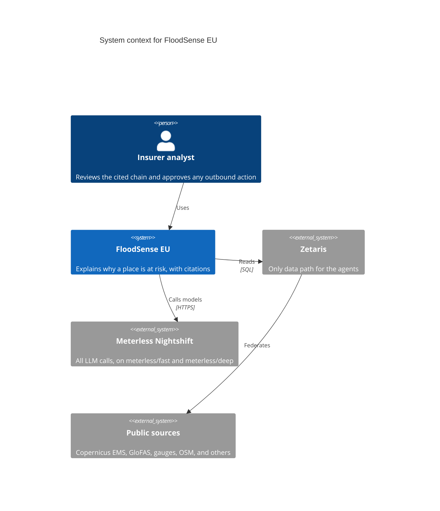
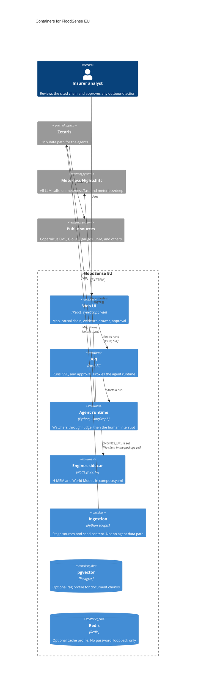
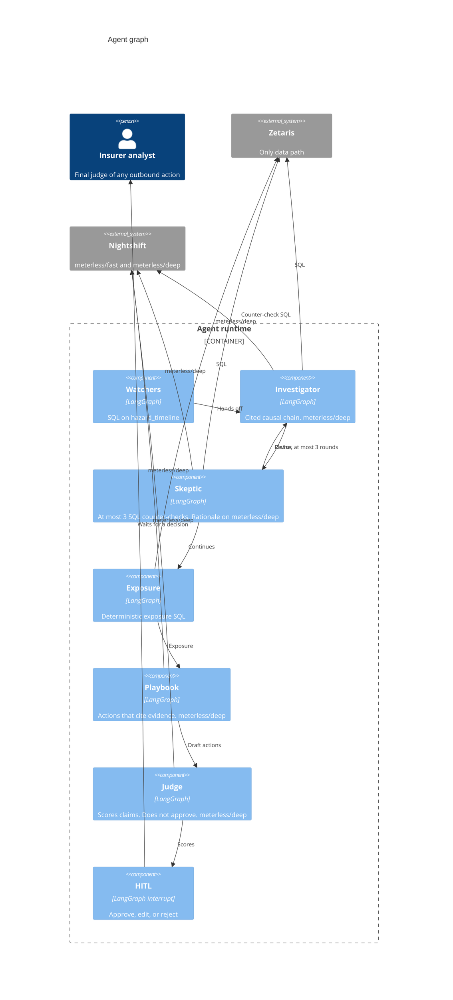

# C4 diagrams

The shapes below are the gameplan. A box is not a running service unless the caption says it is in `compose.yaml` today.

The app sends a Nightshift routing mode. Diagrams below use only those two ids. This is the one map to the model that answers today:

| Lane the app sends | Who calls it | Model that answers today |
| --- | --- | --- |
| `meterless/fast` | Configured. No node in the graph on main calls it | Nemotron 3.5 Super VL 120B A12B (`nvidia/nemotron-3.5-super-vl-120b-a12b`) |
| `meterless/deep` | Investigator, Skeptic rationale, Playbook, Judge | Nemotron 3.5 Super VL 120B A12B (`nvidia/nemotron-3.5-super-vl-120b-a12b`) |

Super VL answers both because it is the faster lane as well as the stronger one. Lightning 30B A3B is a second lane configured in Nightshift. It is not what the app sends. No `meterless/auto` in the demo. Watchers and Exposure are SQL. The Skeptic's counter-checks are SQL. Its rationale uses `meterless/deep`.

## System context

The insurer analyst is the person in the demo. Citizens are named in the business-model slide and are not a second system here. Outbound delivery (mail, webhook, or something else) is not chosen, so it is not drawn. Nothing leaves until the analyst approves.

## Containers

`python tasks.py up` starts the API, the agent runtime, the engines sidecar, and the UI in Compose project `floodsense-app`. pgvector (`rag`) and Redis (`cache`) are optional profiles. Ingestion is scripts and seed content, not a Compose service. The engines sidecar is in `compose.yaml`. Compose sets `ENGINES_URL=http://engines:8300` on the agents service. The agents package does not call that URL yet. On the host the published port is `127.0.0.1:8300`.

Agents do not read public sources themselves, and this diagram does not give them a direct read of pgvector. The gameplan's working assumption that agents might query pgvector, with that Postgres also registered in Zetaris, is unverified (Urvashi). Whether the semantic cache uses the Redis profile is Ayush's v0.12.0 choice, not drawn as a fact.

## Agent graph

`build_graph()` in `agents/floodsense_agents/graph.py` compiles this graph, with a scope gate before Watchers. The Judge scores claims and does not approve them. The human is the final judge, before any outbound action. A Skeptic revise edge goes back to the Investigator, at most three rounds. Lane names in the diagram are `meterless/fast` and `meterless/deep`. The model that answers today is the table at the top of this page.

