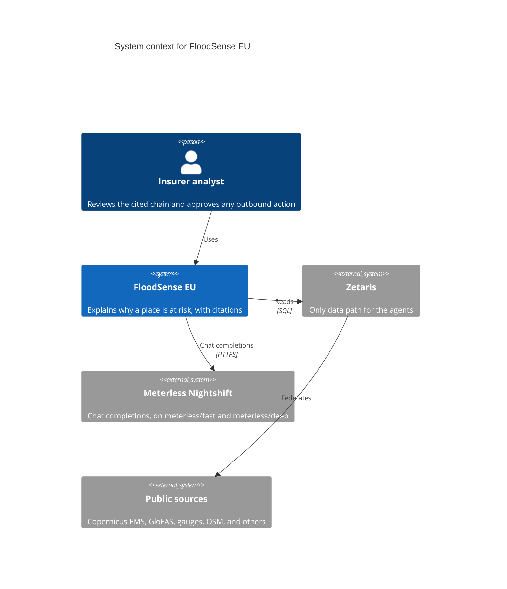
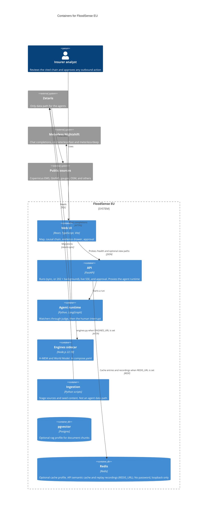
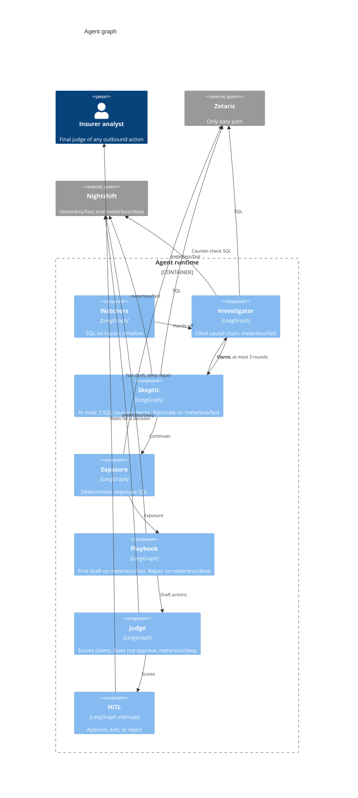

# C4 diagrams

The shapes below are the gameplan. A box is not a running service unless the caption says it is in `compose.yaml` today.

The app sends a Nightshift routing mode. Diagrams below use only those two ids. This is the one map to the model that answers today:

| Lane the app sends | Who calls it | Model that answers today |
| --- | --- | --- |
| `meterless/fast` | Investigator, Skeptic rationale, Playbook first draft | Nemotron 3.5 Lightning 30B A3B (`nvidia/nemotron-3.5-lightning-30b-a3b`), measured 27 Oct 2026 |
| `meterless/deep` | Judge grounding, Playbook repair | Nemotron 3.5 Lightning 30B A3B (`nvidia/nemotron-3.5-lightning-30b-a3b`), measured 27 Oct 2026 |

The lanes are routing modes, not model ids: Nightshift picks the model behind each one. On 27 Oct 2026, every measured call on both lanes (agents logs, bench runs, eval `model_ids`) was answered by Lightning, so pointing a draft at `meterless/fast` is not, by itself, a large wall-time win. The guaranteed gain is running independent Zetaris statements together. The app sends `meterless/fast` and `meterless/deep`, not a model id, unless `MODEL_FAST` is set to one. No `meterless/auto` in the demo. Watchers and Exposure are SQL. The Skeptic's counter-checks are SQL. Its rationale uses `meterless/fast`. Playbook repair and Judge grounding use `meterless/deep`.

## System context

The insurer analyst is the person in the demo. Citizens are named in the business-model slide and are not a second system here. Outbound delivery (mail, webhook, or something else) is not chosen, so it is not drawn. Nothing leaves until the analyst approves.



## Containers

`python tasks.py up` starts the API, the agent runtime, the engines sidecar, and the UI in Compose project `floodsense-app`. pgvector (`rag`) and Redis (`cache`) are optional profiles. Ingestion is scripts and seed content, not a Compose service. The engines sidecar is in `compose.yaml`. Compose sets `ENGINES_URL=http://engines:8300` on the agents service. From `v0.9.0` the agents call that URL: World Model on the URL, H-MEM behind `FF_HMEM` (default off). On the host the published port is `127.0.0.1:8300`. Lane names in this file stay `meterless/fast` and `meterless/deep`. The model that answers today is the table at the top of this page.

Agents do not read public sources themselves. Document ranking stays in pgvector and text, licence, and locator are hydrated through Zetaris JDBC ([ADR 0009](../adr/0009-vector-search-next-to-zetaris.md)). This diagram does not draw a direct agent read of pgvector, because `retrieve_docs` is not in the runtime yet. The API's semantic cache and replay recordings use the Redis profile when `REDIS_URL` is set, and fall back to the API process's memory when it is unset or Redis is down. `GET /views/{name}` also goes through a TTL and stale-if-error cache in the API (`api/app/views_cache.py`), so the REST-backed live views reach Zetaris and Open-Meteo once per TTL, not once per page load; a stale copy is labelled `x-views-cache: stale`.

The React UI is a fixture desk. It does not read `/runs`. It may probe `GET /health` and the optional view paths in `ui/src/config/scenario.ts`. The agents call the engines sidecar through `agents/floodsense_agents/engines.py` (since v0.9.0). The World Model is used when `ENGINES_URL` is set. H-MEM recall and the Learn write run only when `FF_HMEM` is also on, and that flag defaults off. On the host the agents process listens on port 8100 and Compose does not publish it; the API proxies it. From the host, `http://127.0.0.1:8100/console` is the agents console when that process is running outside Compose.



## Agent graph

A chat front door (`agents/floodsense_agents/front_door.py`) runs before the graph: rules plus one bounded fast-lane call sort greeting, help, thanks and off-topic messages from flood questions, and answer small talk with a fixed role-aware `{"kind": "reply"}` (no run, no flood facts). Flood questions go to the graph, and so does any request with an explicit `event_id`, a `replay_ts`, or a `doc_query` that differs from the question (the UI mirrors the question into `doc_query`; that mirror is not explicit). The fast-lane call is made only for a message of at most six words that names no place, and waits at most the API's lookup timeout less 0.5 s (2.5 s by default). A Router agent (`agents/floodsense_agents/router.py`) then picks the run's lane and records it as the first trace entry (`node: "router"`) and on the snapshot (`lane`, `router_reason`): `quick` for a live reading at a known place (rules: a live word plus a place; the fast lane only for ambiguous messages), `full` for why / replay / past dates / exposure / policies / claims / alerts / documents, for every explicit `event_id`, `replay_ts` or `doc_query`, and whenever `FF_LIVE_DATA` is off. The quick lane is Scope (a decline ends the run) → `live_watch` (one Zetaris query per asked place: a gauge via `gauge_latest_sql(schema, stations=…)`, an `eu_watch` point by `point_id`, or a `hazard_now` point) → `quick_answer` (one template claim per place from that place's row, citing only that place's query; the summary is a template lead per place, worst band first, then the claim texts; no model call) → `judge.evaluate` with no model (citation present, cited query returned rows, every stated number is a cell of the cited rows), ending `answered` with no Playbook and no HITL. No row for the place, or any Judge flag, escalates the same run into Watchers and the full lane, with an `escalated: …` trace entry; a declined run is never escalated. A third run lane, `forecast` (`nodes/forecast.py`), takes a forecast cue (next N hours, tomorrow, this week, will … rise, look safe, morgen, mañana) about one of the 45 watched places: Scope → `forecast_data` (parallel Zetaris reads of `weather_forecast`, the Open-Meteo DWD ICON precipitation forecast of migrations 070-073, plus the GloFAS discharge forecast in `eu_watch` / `hazard_now` and the `gauge_levels` level and trend) → `history` (the replay-seed 48 h rain before the 2021 Ahr or 2024 Valencia peak, the top RAG passage via pgvector + Zetaris JDBC, and H-MEM recall from the engines) → `forecast_answer` (deterministic cited claims, a Normal / Watch / Warning screening status with fixed cuts, and a template lead; no model call) → the deterministic Judge, ending `answered` or escalating like the quick lane.

```
scope ── in scope, lane=quick → live_watch → quick_answer → quick_judge ─┬─ pass → END (answered)
                                                                └─ flag / no data → escalate → watchers (full lane)
scope ── in scope, lane=forecast → forecast_data → history → forecast_answer → forecast_judge ─┬─ pass → END (answered)
                                                                                       └─ flag / no data → escalate → watchers
```

`build_graph()` in `agents/floodsense_agents/graph.py` compiles this graph, with a scope gate before Watchers. Learn runs after the human decision and writes to H-MEM only when `FF_HMEM` is on. The Judge scores claims and does not approve them. The human is the final judge, before any outbound action. A Skeptic revise edge goes back to the Investigator, at most three rounds. `POST /runs?wait=false` runs this graph on a background thread (`Runtime.start_async`); each node's checkpoint is readable as it lands, and `GET /runs/{id}/events` streams `started` (from LangGraph's debug stream), `trace` (finished steps, with `model_id` and `duration_ms`) and a final `status`. The Playbook fills the approval-card fields (`action_type`, `title`, `target_region`, `affected_site_count`, `draft_message`); a draft is built from a fixed template and the cited claim texts only. H-MEM recall shows on the run as `memory_used[]`, at run level only, because a claim-to-memory link is not knowable. Lane names in the diagram are `meterless/fast` and `meterless/deep`. The model that answers today is the table at the top of this page.

Watchers read `hazard_timeline`. `hazard_now` is a warehouse view for the rolling window and is not on this graph. Live gauges: the `pegel-poller` container (compose service in the default profile, started by `tasks.py up` / `up-all`; it reaches the separate Zetaris stack only through the mounted Docker socket, `docker cp` into the driver container; healthcheck fails when `live.csv` is older than 2× the 600 s interval; `python tasks.py pegel-poll` stays for manual runs) polls PEGELONLINE → CSV in the Zetaris driver → FILESTORE table `floodsense_live_src.pegel_now_src` → view `floodsense.gauge_levels` (with `is_stale`); agents and UI read only the view. EMSR773 lists no PEGELONLINE station, so the Valencia path does not query `gauge_levels`. Europe live watch (27 Oct 2026): the poller covers 26 stations on ten federal waterways, and `floodsense.eu_watch` (REST table `eu_watch_live_v2`, migrations 060-065) adds 11 GloFAS points outside Germany that Zetaris fetches from Open-Meteo at query time. A question about a watch place (no replay-event place named; a present cue, or a level word and no past cue) runs as its own event `LIVE-EU` ("Europe live watch", `events.WATCH_SPEC`, kept out of `EVENTS`); the Investigator then answers from `gauge_levels` (official MHW band) and/or `eu_watch` (model band, not an official warning) with Zetaris query ids, the Skeptic checks every cited station and point is in its view, and Exposure is skipped. Rhine and Mosel questions keep the EMSR517 gauge path. The Now page shows all 37 sources on one Leaflet map; a click pre-fills Ask. The map's demo line is 80 m³/s (`SIMULATED_ALERT_M3S`). Watchers use `anomaly_discharge`, 100 m³/s. Those are not one constant.


