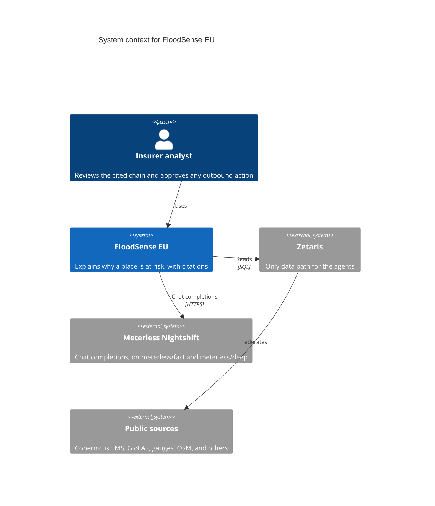
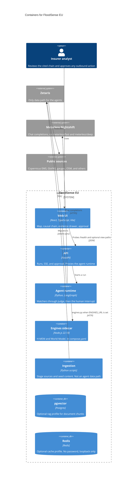
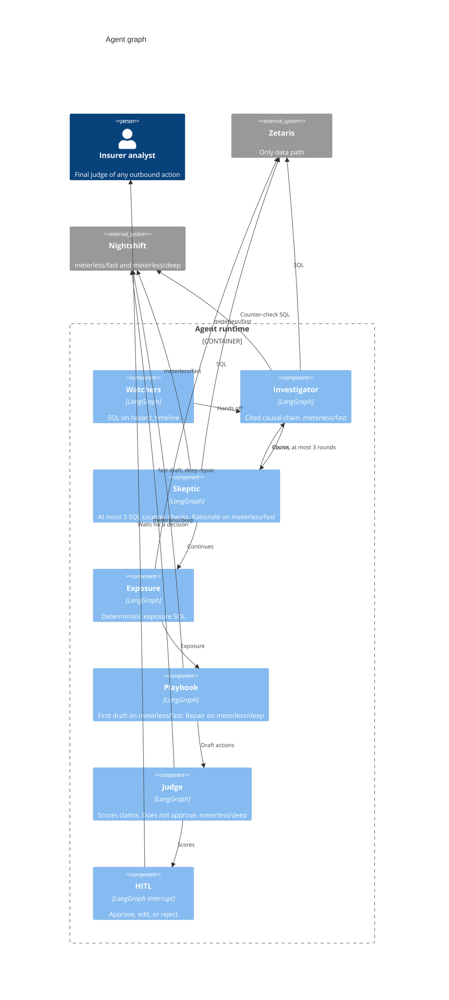

# C4 diagrams

The shapes below are the gameplan. A box is not a running service unless the caption says it is in `compose.yaml` today.

The app sends a Nightshift routing mode. Diagrams below use only those two ids. This is the one map to the model that answers today:

| Lane the app sends | Who calls it | Model that answers today |
| --- | --- | --- |
| `meterless/fast` | Investigator, Skeptic rationale, Playbook first draft | Nemotron 3.5 Super VL 120B A12B (`nvidia/nemotron-3.5-super-vl-120b-a12b`) |
| `meterless/deep` | Judge grounding, Playbook repair | Nemotron 3.5 Super VL 120B A12B (`nvidia/nemotron-3.5-super-vl-120b-a12b`) |

Super VL answers both lanes today, so pointing a draft at `meterless/fast` is not, by itself, a large wall-time win. The guaranteed gain is running independent Zetaris statements together. `meterless/fast` helps when `MODEL_FAST` is a cheaper or faster model, such as Lightning 30B A3B. Lightning is a second lane configured in Nightshift. The app sends `meterless/fast` and `meterless/deep`, not the Lightning model id, unless `MODEL_FAST` is set to that id. No `meterless/auto` in the demo. Watchers and Exposure are SQL. The Skeptic's counter-checks are SQL. Its rationale uses `meterless/fast`. Playbook repair and Judge grounding use `meterless/deep`.

## System context

The insurer analyst is the person in the demo. Citizens are named in the business-model slide and are not a second system here. Outbound delivery (mail, webhook, or something else) is not chosen, so it is not drawn. Nothing leaves until the analyst approves.

## Containers

`python tasks.py up` starts the API, the agent runtime, the engines sidecar, and the UI in Compose project `floodsense-app`. pgvector (`rag`) and Redis (`cache`) are optional profiles. Ingestion is scripts and seed content, not a Compose service. The engines sidecar is in `compose.yaml`. Compose sets `ENGINES_URL=http://engines:8300` on the agents service. From `v0.9.0` the agents call that URL: World Model on the URL, H-MEM behind `FF_HMEM` (default off). On the host the published port is `127.0.0.1:8300`. Lane names in this file stay `meterless/fast` and `meterless/deep`. The model that answers today is the table at the top of this page.

Agents do not read public sources themselves. Document ranking stays in pgvector and text, licence, and locator are hydrated through Zetaris JDBC ([ADR 0009](../adr/0009-vector-search-next-to-zetaris.md)). This diagram does not draw a direct agent read of pgvector, because `retrieve_docs` is not in the runtime yet. Whether the semantic cache uses the Redis profile is Ayush's v0.12.0 choice, not drawn as a fact.

The React UI is a fixture desk. It does not read `/runs`. It may probe `GET /health` and the optional view paths in `ui/src/config/scenario.ts`. The agents call the engines sidecar through `agents/floodsense_agents/engines.py` (since v0.9.0). The World Model is used when `ENGINES_URL` is set. H-MEM recall and the Learn write run only when `FF_HMEM` is also on, and that flag defaults off. On the host the agents process listens on port 8100 and Compose does not publish it; the API proxies it. From the host, `http://127.0.0.1:8100/console` is the agents console when that process is running outside Compose.

## Agent graph

`build_graph()` in `agents/floodsense_agents/graph.py` compiles this graph, with a scope gate before Watchers. Learn runs after the human decision and writes to H-MEM only when `FF_HMEM` is on. The Judge scores claims and does not approve them. The human is the final judge, before any outbound action. A Skeptic revise edge goes back to the Investigator, at most three rounds. Lane names in the diagram are `meterless/fast` and `meterless/deep`. The model that answers today is the table at the top of this page.

Watchers read `hazard_timeline`. `hazard_now` is a warehouse view for the rolling window and is not on this graph. EMSR773 lists no PEGELONLINE station, so the Valencia path does not query `gauge_levels`. The map's demo line is 80 m³/s (`SIMULATED_ALERT_M3S`). Watchers use `anomaly_discharge`, 100 m³/s. Those are not one constant.

