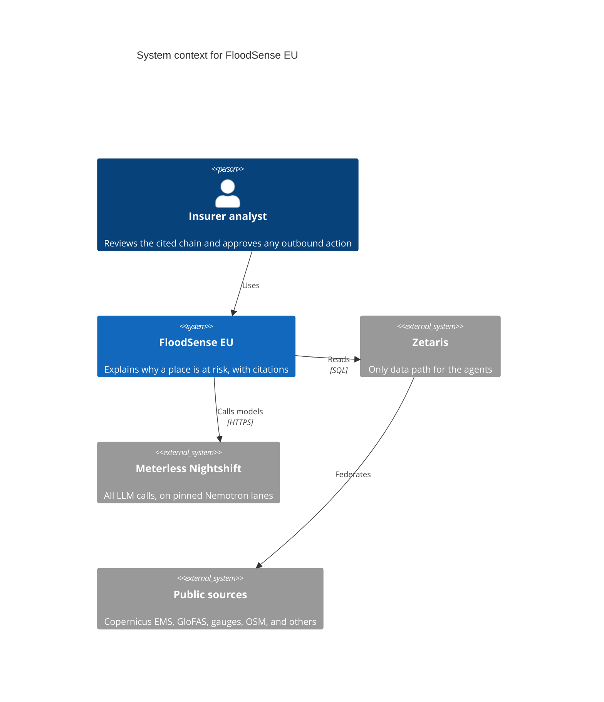
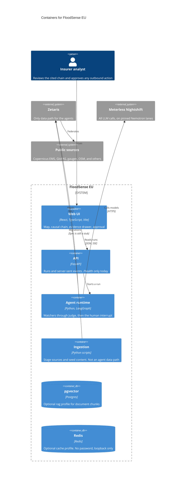
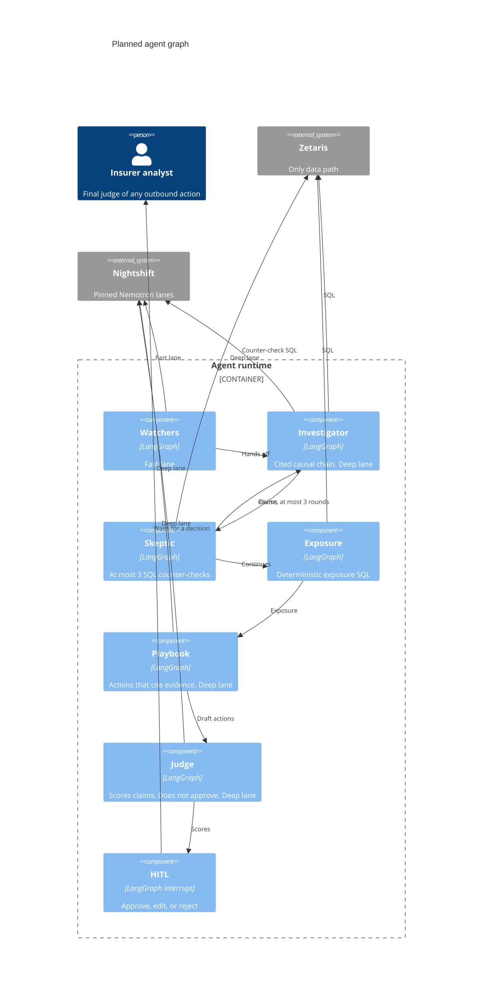

# C4 diagrams

The shapes below are the gameplan. A box is not a running service unless the caption says it is in `compose.yaml` today.

Two Nemotron lanes, for the calls that use a model. The app sends a Nightshift routing mode and the lanes configured in Nightshift pick the model:

- Fast: `meterless/fast`, answered by `nvidia/nemotron-3.5-lightning-30b-a3b`
- Deep: `meterless/deep`, answered by `nvidia/nemotron-3.5-super-vl-120b-a12b`

No `meterless/auto` in the demo. The Skeptic and Exposure nodes are SQL in the gameplan, so the component diagram does not give them a model call.

## System context

The insurer analyst is the person in the demo. Citizens are named in the business-model slide and are not a second system here. Outbound delivery (mail, webhook, or something else) is not chosen, so it is not drawn. Nothing leaves until the analyst approves.

## Containers

`python tasks.py up` starts the API, the agent runtime, and the UI in Compose project `floodsense-app`. pgvector (`rag`) and Redis (`cache`) are optional profiles. Ingestion is scripts and seed content, not a Compose service. The H-MEM and World Model engines sidecar is not in this diagram: `engines/` does not exist yet.

Agents do not read public sources themselves, and this diagram does not give them a direct read of pgvector. The gameplan's working assumption that agents might query pgvector, with that Postgres also registered in Zetaris, is unverified (Urvashi). Whether the semantic cache uses the Redis profile is Ayush's v0.12.0 choice, not drawn as a fact.

## Agent graph

Planned order from `agents/floodsense_agents/graph.py`. The graph is not compiled. The Judge scores claims and does not approve them. The human is the final judge, before any outbound action. A Skeptic revise edge goes back to the Investigator, at most three rounds.

