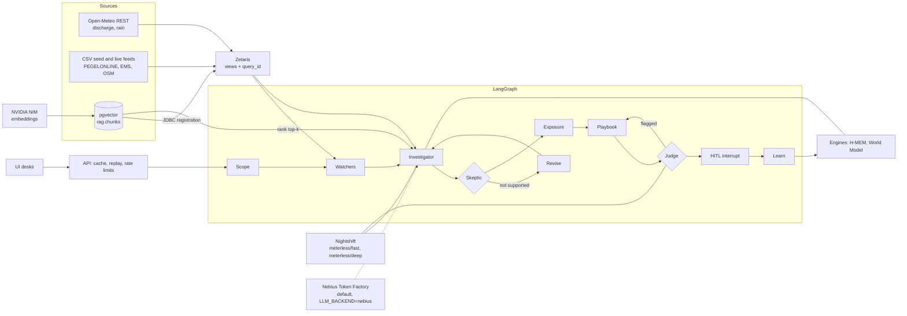

# Technical highlights

Each item links to the code that shows it. Paths are relative to the repository root.

## Data and agent flow

## Agent graph

- LangGraph `StateGraph` with a Skeptic revise loop and a Judge repair loop: `agents/floodsense_agents/graph.py`.
- Human approval with LangGraph `interrupt()`: `agents/floodsense_agents/hitl.py` ([ADR 0005](../adr/0005-human-approval-before-outbound-action.md)).
- SQLite checkpointer behind one lock, so a long `POST /runs` and a concurrent `GET` do not hang: `agents/floodsense_agents/checkpoints.py`.
- Scope node declines out-of-scope questions with no data read and no model call: `agents/floodsense_agents/nodes/scope.py`.

## Citations

- Three layers: (a) Zetaris data rows with `query_id`, (b) source provenance (`zetaris/migrations/015_create_view_provenance.sql`), (c) document passages. Model: `agents/floodsense_agents/models.py`.
- Layer (c) quotes carry `content_sha256`. The Judge recomputes the hash of the quote and of the stored passage text and rejects a mismatch: `agents/floodsense_agents/nodes/judge.py`.

## Zetaris federation

- FILESTORE tables over CSV: `zetaris/migrations/010_seed_sources.sql`, `033_live_feed_tables.sql`.
- REST tables over Open-Meteo: `003_create_rest_table_glofas_discharge.sql`, `030_create_rest_table_glofas_discharge_live.sql`, `032_create_rest_table_rain_live.sql`.
- pgvector registered as a JDBC datasource: [ADR 0009](../adr/0009-vector-search-next-to-zetaris.md), `pgvector/README.md`.
- Numbered migrations with verify comments (for example `-- min_rows: 8`) and a sync ledger: `scripts/zetaris_sync.py`, tests in `scripts/tests/test_zetaris_sync.py`.
- CI runs the migrations as a dry run: `.github/workflows/ci.yml`.

## RAG (citation layer c)

- `rag.chunks` stores `vector(2048)`. The HNSW index is on `embedding::halfvec(2048)` with `halfvec_cosine_ops`, because a plain `vector` HNSW index stops at 2000 dimensions: `pgvector/migrations/001_rag_chunks.sql`, `002_rag_embed_model_nemotron35.sql`.
- Ranking runs in Postgres and returns chunk ids and distances. Text, licence and locator are then read through Zetaris, so every passage has a `query_id`: `agents/floodsense_agents/retrieve_docs.py`.
- Agents never put `<=>` in Zetaris SQL. Zetaris reads it as null-safe equality (ADR 0009).
- Embeddings: `agents/floodsense_agents/nim_embed.py`, ingest `scripts/rag_ingest.py`. Behind `FF_RAG_DOCS`.

## Web context (Tavily)

`agents/floodsense_agents/tavily.py` calls `POST https://api.tavily.com/search` (Bearer key, `topic=news`, `time_range=week`, 3 results) behind `FF_TAVILY` (default off, key in `TAVILY_API_KEY`). It has a timeout, a 15 min in-process cache keyed by (place, query), and a one-call-per-second guard; any failure returns "unavailable" and the run goes on. Each snippet becomes a claim `C-web-N` with a layer (c) citation (URL, title, retrieval time, locator `lines: "web snippet"`) over an evidence row `web.tavily`, so the Judge checks the quote hash like any document. The claim text starts "Web context, not an official warning" and carries no `numbers`. The snippet and title pass through `tavily.clean` first (digits and units replaced by `[n]`, control characters, markup, quotes and newlines stripped, length capped) and sit only inside a quoted excerpt, so web text can neither supply a figure the Judge would skip nor act as instructions. The Investigator records the call as a `tavily` trace entry (query, result count, latency, cached yes/no, no key) and hands the cleaned snippets to the Skeptic through `state["web"]`. The Skeptic asks the fast lane whether a web snippet supports, contradicts or is neutral on one alert-timing or status claim; the reply is accepted only with a verdict from that set and a URL that is one of the snippets, and appears as `web_check <verdict> <claim> <url>` in the Skeptic trace. It never flips a hypothesis verdict. With the flag off or the call unavailable the check does not run. The UI lists web citations in the evidence drawer and shows a Tavily tile in the "How this answer was made" panel; with `LLM_BACKEND=nebius` the model tile is named Nebius Token Factory and lists per-run calls, tokens and cost (price not configured unless set).

## Live mode

- `hazard_now` view with past and forecast rows and a horizon label: `zetaris/migrations/034_create_view_hazard_now.sql`, `039_label_hazard_now_horizon.sql`.
- Mode classifier: a "now" question goes live, a past-event question goes to event mode: `classify()` in `agents/floodsense_agents/live.py`.
- Staleness: an old sync is flagged "stale" in the answer: `agents/floodsense_agents/live.py:40` (`STALE_FORECAST_H`).
- The answer cache is keyed on the effective mode, so a live answer and an event answer never share a cache entry: `api/app/cache.py`.

## Views cache and prewarm

- `GET /views/{name}` is cached per view and query string, single flight, with stale-if-error up to 24 h: `api/app/views_cache.py`.
- A background task (`ViewsCache.prewarm`) fills `gauge_levels`, `eu_watch`, `hazard_now` and the other live views at startup, 5 s apart, then re-checks every `VIEWS_PREWARM_INTERVAL_S` (default 120 s, floor 30, 0 = fill once) and refreshes a view only near its TTL (about once per 600 s for the Open-Meteo views), with a doubling backoff (cap 1 h) after a failure. It shares the request path's single flight, tolerates upstream errors (the old copy stays and is served as `stale`), and is cancelled on shutdown. Copies keep their own `x-query-id` and age; prewarmed data is never relabelled as freshly queried. The TTL, not the interval, sets the call rate, because `eu_watch` makes many Open-Meteo free-tier calls.

## Semantic cache and labelled replay

- `served_from` is `live`, `cache` or `replay`. `cached_at` keeps the original time. A cached or replayed answer is never shown as live: `api/app/cache.py`, `api/app/main.py` ([ADR 0006](../adr/0006-labelled-cache-and-replay.md)).
- `{"fresh": true}` skips the cache. Flags `FF_SEMANTIC_CACHE` and `FF_CACHED_REPLAY`.
- Redis backend (merged, PR #56): with `REDIS_URL` set and reachable, cache entries and recordings live in Redis (`cache` compose profile). If Redis is unset, fails or is slow, the API falls back to the local store and retries after `REDIS_RETRY_S`; a Redis problem never fails a request: `api/app/cache.py`.

## Rate limits

- Per-client token bucket on `POST /runs` and a cap on live runs in flight. Both answer 429 with `Retry-After`. A cache hit does not take a slot. GET routes are not limited: `api/app/ratelimit.py`.
- When the live-run cap is full and `FF_CACHED_REPLAY` is on, `POST /runs` first looks for a labelled replay of the same question and returns it with 200. Only if there is none does it answer 429. The per-client token bucket is checked first and always answers 429: `start_run` in `api/app/main.py`.

## Under the hood page

`ui/src/components/stack/` draws one card per technology from real responses: `/platform/status` (backend, lanes, latency, cache, rate limit, usage), `/system` (memory, events, hypotheses, cache keys) and a recorded run (trace for the agent pool, `usage`, `evidence` with `query_id` and `row_count`, `memory_used`). Pure mappers in `ui/src/lib/stack.ts` are unit tested. Each card is badged LIVE, REPLAY or SAMPLE; a missing field is an empty state, never an animated guess. Not verified here: a run streaming over SSE end to end (the follow path reuses `subscribeRunEvents`).

## Sponsor stack in the UI

`SponsorStrip` shows Nebius, Nemotron (lane model ids), Tavily (calls), Zetaris and Meterless with a dot from `GET /platform/status` (Meterless is grey "unknown": that endpoint carries no memory status); an unreachable API shows "unavailable", not green. The citizen strip is plain: names and dots only, no counts or model ids. Desks show the Tavily web check as plain words ("A web report supports this", "A web report conflicts with this", "No clear web confirmation") with up to three links, always labelled "Web context, not an official warning" and "From the latest checked answer"; the citizen desk shows it only when that answer is about the selected place, with no numbers, event ids or timestamps (only "checked a few minutes ago" style phrases). The region badge is read from the model list (`llm_usage.pricing`), so the deep Super VL model can show US while the fast lane shows EU (Finland). Tests: `ui/src/lib/sponsors.test.tsx`. Not verified: rendering in a browser.

## Agents at work (`<AgentsLive/>`)

`ui/src/components/agents/AgentsLive.tsx` animates the eight core agents (scope, watchers, memory, investigator, skeptic, exposure, playbook, judge) with idle/running/done status, durations, a handoff dot on the wire between agents, revise/repair loop chips, tool-call chips (Zetaris SQL view reads, H-MEM recall, World Model steps; shown only when the recorded run's `evidence`, `memory_used` or `world_model` trace steps show them), the run's `served_from` as a Cache hit / Computed live / Replayed badge, the global cache counters, a rate-limit lane (`in_flight`/`max_concurrent`, `runs_per_min`, recent 429s, and a Retry-After countdown when `/watch/events` answers 429 with that header), model lanes with calls, tokens and latency from `/platform/status`, and the latest watch events. The hook `useAgentsLiveFrom` (`ui/src/hooks/useAgentsLive.ts`) merges the stack poll (platform status every 5 s, a running run over `subscribeRunEvents`), the `/watch/stream` SSE plus a 15 s `/watch/events` poll, and the newest recorded run. With no run streaming it replays the newest recorded trace on timers (each step's latency divided by 10, clamped to 0.5 to 1.6 s, 5 s hold, loop), badged REPLAY (or SAMPLE for the bundled run), never LIVE. Under `prefers-reduced-motion` it shows the finished trace and no loop. `<AgentsLive compact/>` drops tool chips, lanes and the watch list for embedding in desk pages; `<AgentsLive stack={useStackData()}/>` reuses a page's own poll. Mounted on the Under the hood page and, as "Watch the agents", on the Control tower. Pure logic: `ui/src/lib/agentsLive.ts`, tests in `ui/src/lib/agentsLive.test.ts`. Not verified: a live run end to end in a browser, and tool chips during a live run (evidence only exists once the run ends).

## Contracts

- One JSON Schema shared by agents, API and UI: `contracts/schemas/floodsense.schema.json`, with Python and TypeScript bindings in `contracts/python` and `contracts/typescript`. Tests: `contracts/tests`. See [ADR 0007](../adr/0007-json-schema-contracts.md).

## CI

- `.github/workflows/ci.yml`: lint (tracked-`.env` check, ruff, TypeScript), tests (`python tasks.py test`), gitleaks secret scan, Zetaris migration dry run, and engines tests on Node 22.18.

## Honesty rules

- No "Live" chip unless the answer is live (`ui/src/components/Banners.tsx`, `AskFloodSense.tsx`, `api/app/main.py`).
- The insurer portfolio is labelled synthetic in the data (`zetaris/migrations/018_label_exposure_synthetic.sql`) and the UI (`ui/src/components/Portfolio.tsx`).
- Every chat completion goes through one backend: Nebius Token Factory by default, or Meterless Nightshift with `LLM_BACKEND=nightshift` (no other provider path; `agents/floodsense_agents/nightshift.py`, [ADR 0004](../adr/0004-nightshift-only-llm-calls.md), written when Nightshift was the only path).

## Test counts

Python suites run on 27 Oct 2026 on branch `docs/release-v1` at `main` `c9ff924`, Windows, Python 3.12 (the UI row was not re-run for the release and is from an earlier `main`).

| Suite | Command | Result |
| --- | --- | --- |
| agents | `python -I -m unittest discover -s tests` in `agents/` | 579 passed |
| api | `python -I -m unittest discover -s tests` in `api/` | 220 passed |
| scripts | `python -I -m unittest discover -s scripts/tests` | 129 passed |
| contracts | `python -I -m unittest discover -s contracts/tests` | 12 passed |
| ui | `npx vitest run` in `ui/` | 128 passed (19 files) |

CI runs the same suites with `python tasks.py test` on every pull request.

## Model-call evidence (Nebius backend)

Every model call passes `NightshiftClient._send`, which records the reply's `usage` per lane and model id into a per-run meter (`usage` on the run result) and a process meter (`/platform/status`). `check-llm` proves each lane answers with a Nemotron model id. Cost comes from the official per-model prices in the Token Factory model list (cached 1 h; `NEBIUS_PRICE_PER_M_INPUT/OUTPUT` override), per lane, per run and per answer, with rpm/tpm limits and region per lane in `/platform/status`. Paced by `NEBIUS_RPM` / `NEBIUS_MAX_CONCURRENCY`, defaulting to a quarter of the published rpm. Verified live on 30 Oct 2026: lane check fast 1.1 s, deep 30.4 s; Ahr EMSR517 full lane 148 s (12 calls, 44,569 tokens); Valencia EMSR773 281 s (14 calls, 40,370 tokens); every claim judged. Unit tests use fakes.
