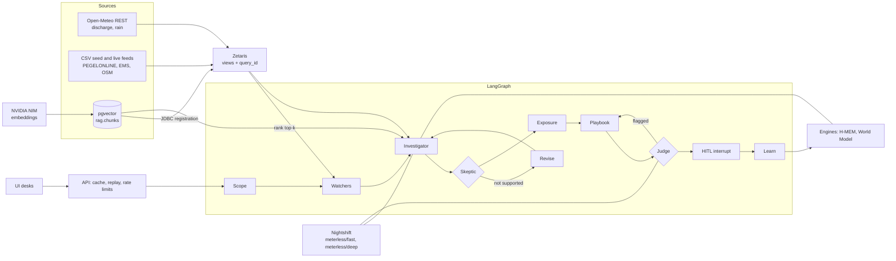

# Technical highlights

Each item links to the code that shows it. Paths are relative to the repository root.

## Data and agent flow

## Agent graph

- LangGraph `StateGraph` with a Skeptic revise loop and a Judge repair loop: `agents/floodsense_agents/graph.py`.
- Human approval with LangGraph `interrupt()`: `agents/floodsense_agents/hitl.py` ([ADR 0005](../adr/0005-human-approval-before-outbound-action.md)).
- SQLite checkpointer behind one lock, so a long `POST /runs` and a concurrent `GET` do not hang: `agents/floodsense_agents/checkpoints.py`.
- Scope node declines out-of-scope questions with no data read and no model call: `agents/floodsense_agents/nodes/scope.py`.

## Citations

- Three layers: (a) Zetaris data rows with `query_id`, (b) source provenance (`zetaris/migrations/015_create_view_provenance.sql`), (c) document passages. Model: `agents/floodsense_agents/models.py`.
- Layer (c) quotes carry `content_sha256`. The Judge recomputes the hash of the quote and of the stored passage text and rejects a mismatch: `agents/floodsense_agents/nodes/judge.py`.

## Zetaris federation

- FILESTORE tables over CSV: `zetaris/migrations/010_seed_sources.sql`, `033_live_feed_tables.sql`.
- REST tables over Open-Meteo: `003_create_rest_table_glofas_discharge.sql`, `030_create_rest_table_glofas_discharge_live.sql`, `032_create_rest_table_rain_live.sql`.
- pgvector registered as a JDBC datasource: [ADR 0009](../adr/0009-vector-search-next-to-zetaris.md), `pgvector/README.md`.
- Numbered migrations with verify comments (for example `-- min_rows: 8`) and a sync ledger: `scripts/zetaris_sync.py`, tests in `scripts/tests/test_zetaris_sync.py`.
- CI runs the migrations as a dry run: `.github/workflows/ci.yml`.

## RAG (citation layer c)

- `rag.chunks` stores `vector(2048)`. The HNSW index is on `embedding::halfvec(2048)` with `halfvec_cosine_ops`, because a plain `vector` HNSW index stops at 2000 dimensions: `pgvector/migrations/001_rag_chunks.sql`, `002_rag_embed_model_nemotron35.sql`.
- Ranking runs in Postgres and returns chunk ids and distances. Text, licence and locator are then read through Zetaris, so every passage has a `query_id`: `agents/floodsense_agents/retrieve_docs.py`.
- Agents never put `<=>` in Zetaris SQL. Zetaris reads it as null-safe equality (ADR 0009).
- Embeddings: `agents/floodsense_agents/nim_embed.py`, ingest `scripts/rag_ingest.py`. Behind `FF_RAG_DOCS`.

## Live mode

- `hazard_now` view with past and forecast rows and a horizon label: `zetaris/migrations/034_create_view_hazard_now.sql`, `039_label_hazard_now_horizon.sql`.
- Mode classifier: a "now" question goes live, a past-event question goes to event mode: `classify()` in `agents/floodsense_agents/live.py`.
- Staleness: an old sync is flagged "stale" in the answer: `agents/floodsense_agents/live.py:40` (`STALE_FORECAST_H`).
- The answer cache is keyed on the effective mode and provider, so a live answer and an event answer never share a cache entry: `api/app/cache.py`.

## Semantic cache and labelled replay

- `served_from` is `live`, `cache` or `replay`. `cached_at` keeps the original time. A cached or replayed answer is never shown as live: `api/app/cache.py`, `api/app/main.py` ([ADR 0006](../adr/0006-labelled-cache-and-replay.md)).
- `{"fresh": true}` skips the cache. Flags `FF_SEMANTIC_CACHE` and `FF_CACHED_REPLAY`.
- Redis backend (merged, PR #56): with `REDIS_URL` set and reachable, cache entries and recordings live in Redis (`cache` compose profile). If Redis is unset, fails or is slow, the API falls back to the local store and retries after `REDIS_RETRY_S`; a Redis problem never fails a request: `api/app/cache.py`.

## Rate limits

- Per-client token bucket on `POST /runs` and a cap on live runs in flight. Both answer 429 with `Retry-After`. A cache hit does not take a slot. GET routes are not limited: `api/app/ratelimit.py`.
- When the live-run cap is full and `FF_CACHED_REPLAY` is on, `POST /runs` first looks for a labelled replay of the same question and returns it with 200. Only if there is none does it answer 429. The per-client token bucket is checked first and always answers 429: `start_run` in `api/app/main.py`.

## Contracts

- One JSON Schema shared by agents, API and UI: `contracts/schemas/floodsense.schema.json`, with Python and TypeScript bindings in `contracts/python` and `contracts/typescript`. Tests: `contracts/tests`. See [ADR 0007](../adr/0007-json-schema-contracts.md).

## CI

- `.github/workflows/ci.yml`: lint (tracked-`.env` check, ruff, TypeScript), tests (`python tasks.py test`), gitleaks secret scan, Zetaris migration dry run, and engines tests on Node 22.18.

## Honesty rules

- No "Live" chip unless the answer is live (`ui/src/components/Banners.tsx`, `AskFloodSense.tsx`, `api/app/main.py`).
- The insurer portfolio is labelled synthetic in the data (`zetaris/migrations/018_label_exposure_synthetic.sql`) and the UI (`ui/src/components/Portfolio.tsx`).
- The faster provider switch is test-only and off by default (`LLM_PROVIDER_SWITCH`, `agents/floodsense_agents/nightshift.py`).

## Test counts

Python suites run on 27 Oct 2026 on branch `docs/release-v1` at `main` `c9ff924`, Windows, Python 3.12 (the UI row was not re-run for the release and is from an earlier `main`).

| Suite | Command | Result |
| --- | --- | --- |
| agents | `python -I -m unittest discover -s tests` in `agents/` | 579 passed |
| api | `python -I -m unittest discover -s tests` in `api/` | 220 passed |
| scripts | `python -I -m unittest discover -s scripts/tests` | 129 passed |
| contracts | `python -I -m unittest discover -s contracts/tests` | 12 passed |
| ui | `npx vitest run` in `ui/` | 128 passed (19 files) |

CI runs the same suites with `python tasks.py test` on every pull request.
